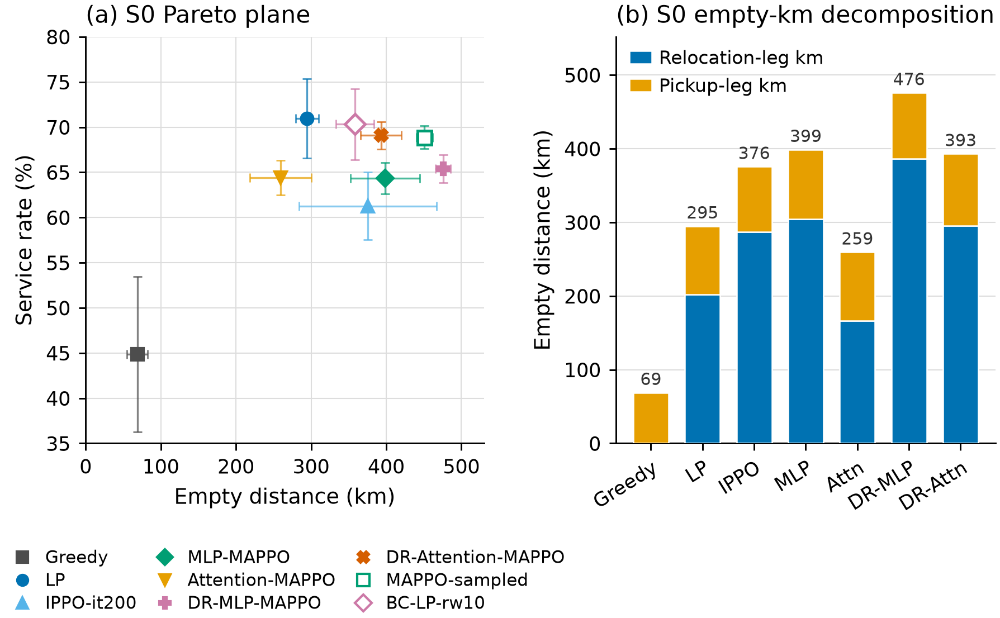
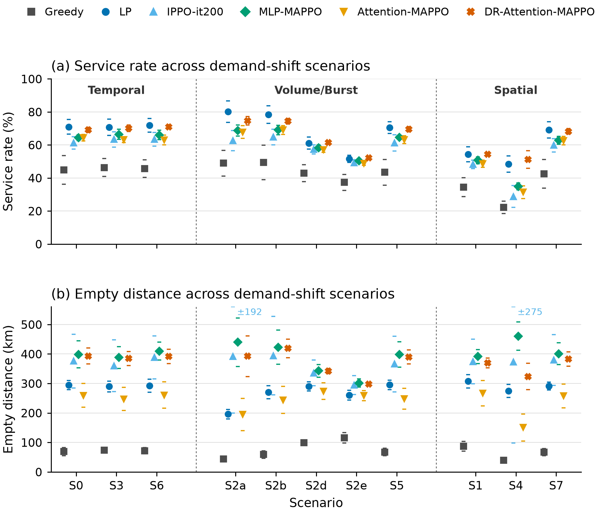
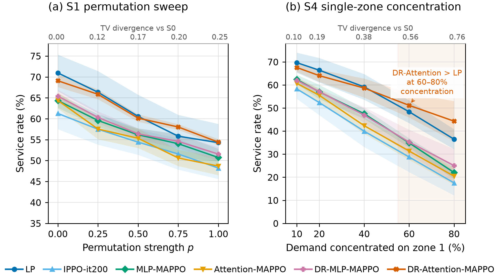
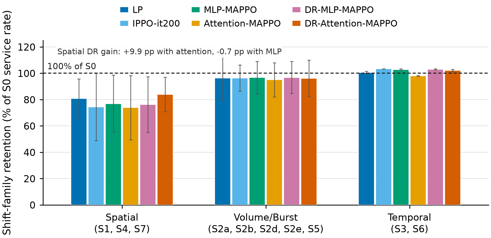

# MARL Fleet Rebalancing Under Demand Shift

**Research question:** How does a frozen fleet-rebalancing policy degrade when
passenger demand at deployment differs from the demand it was trained on, and
what closes the gap to a tuned non-RL baseline?

This is a **measurement study with a targeted mitigation**, not an algorithm
paper. We train on one demand distribution, freeze the policy, stress-test it
on a parameterized family of shifted distributions (S0–S7), and report every
service change together with the empty distance it costs. Scope and research
intent are defined in `INTENT.md`; agents must refuse work that contradicts it.

The paper asks four questions:

- **RQ1:** How much does performance degrade under temporal, volume/burst, and
  spatial shifts?
- **RQ2:** Do independent (IPPO) and shared-critic (MAPPO) learners degrade
  differently?
- **RQ3:** How do they compare with a tuned LP rebalancer, and what mechanisms
  explain the learned-to-LP gap?
- **RQ4:** Can permutation-equivariant architecture and training-time domain
  randomisation close the gap under spatial shift? The mitigation is the
  `ZoneAttentionEncoder` × `--domain-randomize` 2×2 study.

## Setup

```bash
curl https://mise.jdx.dev/install.sh | sh   # if mise is not already installed
mise install                                 # Python 3.14, just, uv
mise exec -- uv sync                         # creates .venv and installs deps
```

If Python 3.14 and uv are already on the path, `uv sync` alone is enough.
Run the tests with `uv run pytest`. `main.py` is a visualization smoke test
only; experiments never import from it.

## Data (NYC16)

Two files are downloaded manually from NYC TLC. Both are git-ignored and live
under `dataset/`.

1. Taxi zone shapefile: `https://d37ci6vzurychx.cloudfront.net/misc/taxi_zones.zip`
   unpacked into `dataset/taxi_zones/`. The archive nests a read-only
   `taxi_zones/` folder; the unpack recipe is in `docs/nyc-pipeline.md`.
2. HVFHV trip records, April 2026:
   `https://d37ci6vzurychx.cloudfront.net/trip-data/fhvhv_tripdata_2026-04.parquet`
   (510 MB) saved as `dataset/fhvhv_tripdata_2026-04.parquet`.

Build the road network and the split windows, then cut the 16-zone study build:

```bash
uv run python -m ride_gym.data_tools.nyc.zone_centroids
uv run python -m ride_gym.data_tools.nyc.build_nyc_network
uv run python -m ride_gym.data_tools.nyc.build_splits
uv run python scripts/build_zone_subset.py --num-zones 16
```

Stage 2 (`preprocess_orders`) is optional: nothing in the study reads its
output. Full stage-by-stage detail, expected file layout and the degree-vs-metre
gotcha are in `docs/nyc-pipeline.md`.

## Training and evaluation

```bash
# Train one seed (use --algo ippo for the independent arm)
uv run python -m marl_fleet_rebalancing.experiments.train \
    --env nyc --algo mappo --seed 0 --iterations 200

# Evaluate a checkpoint on 12 held-out validation windows (argmax by default)
uv run python -m marl_fleet_rebalancing.experiments.evaluate \
    --env nyc --checkpoint results/repro_nyc16_v1.0.0/checkpoints/mappo/seed0/checkpoint_it0200.pt \
    --episodes 12 --base-seed 12000

# S0-S7 shift evaluation for every run, plus the greedy and LP baselines
uv run python -m marl_fleet_rebalancing.experiments.shift_eval \
    --all-runs --include-baselines --episodes 5

# Re-tune the LP on training windows; aggregate results across seeds
uv run python scripts/tune_lp_objective.py
uv run python scripts/aggregate_seeds.py --results results/shift_eval_nyc
```

A 200-iteration NYC16 run takes about 75 minutes on a 12-core CPU; the env
rollout, not the PPO update, dominates. The `just` wrappers are optional, e.g.
`just train-mappo env=nyc iters=200 rollouts=6` (the recipe defaults to three
rollout episodes, not the paper's six). Every environment and reward constant
lives in `NYCConfig` in `src/marl_fleet_rebalancing/config.py`; nothing numeric
is set inside the training loop.

### 12-window paired study

The paper's main grid trains the baseline MLP arms for five seeds and evaluates
the final iterate (`checkpoint_it0200.pt`, it200) on 12 paired windows
(`seeds 1000..1011`) with sequential zone-by-zone AEC stepping. The reproduction
archive's baseline checkpoints are expected under
`results/repro_nyc16_v1.0.0/checkpoints/` by the evaluation script.

```bash
# Baseline MLP arms; repeat --seed 0..4 for the five reported seeds.
# Use --arch attention for the equivariant trunk.
uv run python -m marl_fleet_rebalancing.experiments.train \
    --env nyc --algo mappo --arch mlp --seed 0 --iterations 200 \
    --eval-interval 50 --eval-episodes 12 \
    --device cpu --num-workers 4
uv run python -m marl_fleet_rebalancing.experiments.train \
    --env nyc --algo ippo --arch mlp --seed 0 --iterations 200 \
    --eval-interval 50 --eval-episodes 12 \
    --device cpu --num-workers 4

# Full paired study: main grid, ablations and spatial sweeps.
# Writes results/full_study_v2/.
uv run python scripts/eval_full_study.py --workers 4
```

The paper reports it200 on the 12 paired windows. `checkpoint_best.pt` is
reported only as an ablation; validation-based checkpoint selection uses the
held-out validation split and never the test split.

### Plan B: equivariance × domain randomisation

Plan B trains three MAPPO arms for five seeds each: attention alone
(`--arch attention`), DR alone (`--arch mlp --domain-randomize`), and the
combination (`--arch attention --domain-randomize`). Runs live under
`runs/plan_b/`; the queue is resumable and trains one job at a time.

```bash
# Train attention / DR-MLP / DR-attention MAPPO arms (five seeds each).
uv run python scripts/run_plan_b_overnight.py

# Evaluate the Plan B checkpoints on the same 12 paired windows.
# Writes results/plan_b_v1/.
uv run python scripts/eval_plan_b.py --workers 4

# Regenerate the paper's PDF + 300 dpi PNG figures in docs/paper_v2/figs/.
uv run python scripts/plot_paper_v2.py
```

## Results figures

Current paper figures, generated by `scripts/plot_paper_v2.py` at 300 dpi:






Caveat: the main curves use deterministic argmax actions. On NYC16 S0, sampled
actions raise IPPO to `69.2%` and MAPPO to `68.9%`, but at `447.1` and `451.0`
km empty distance, against `61.3%` / `64.3%` argmax. Sampling buys service with
distance and is not a free fix.

## Reproducibility archive

`results/nyc16-marl-fleet-rebalancing-repro-v1.0.0.tar.gz` (49 MB, 115 files,
SHA-256
`3c3f9500d26738d99085a3dd3cb1dd47cc94252bcdd3751915aeb056c0c2bfb2`)
archives the baseline `MLP` IPPO/MAPPO checkpoints and the raw evaluation
outputs behind `results/full_study_v2/`. It does not contain the Plan B arms.
Plan B training runs live in `runs/plan_b/` and its evaluation outputs in
`results/plan_b_v1/`. The ANT 2027 paper source, compiled PDF and submission
archive live in `docs/paper_v2/`.

The tarball is not in git, because checkpoints are git-ignored; it is available
from the authors on request. After unpacking, verify it with:

```bash
sha256sum -c SHA256SUMS
```

`MANIFEST.json` records the two training commits (MAPPO
`f570f22a11ad26cbb18d0c96f10531fffdec23e0`, IPPO
`819f7a5fa7c4ab8b2a6aa17fc7a642a6d07b169b`), the packaging commit, the
observation/state/action dimensions, the evaluation protocol and per-file
hashes. Re-evaluating the tabulated baseline values from this archive is exact;
bit-exact retraining is not claimed.

## Repo map

| Path | What it is |
|---|---|
| `docs/HANDOFF.md` | Current state, what's broken, what's next |
| `docs/demand-shift.md` | S0–S7 shift taxonomy (scenario IDs) |
| `docs/architecture.md` | Module map, KPI definitions |
| `docs/nyc-pipeline.md` | NYC data build, file layout and gotchas |
| `src/marl_fleet_rebalancing/` | `env/` (PettingZoo wrapper), `agents/` (IPPO/MAPPO), `baselines/` (greedy, LP), `experiments/` (train, shift_eval, plotting), `demand/`, `config.py` |
| `src/marl_fleet_rebalancing/networks/encoder.py` | MLP and permutation-equivariant `ZoneAttentionEncoder` policy trunks |
| `scripts/eval_full_study.py` | 12-window paired main grid, ablations, spatial sweeps → `results/full_study_v2/` |
| `scripts/run_plan_b_overnight.py` | Resumable Plan B training queue → `runs/plan_b/` |
| `scripts/eval_plan_b.py` | Plan B 12-window paired evaluation → `results/plan_b_v1/` |
| `scripts/plot_paper_v2.py` | Paper figures → `docs/paper_v2/figs/` |
| `tests/test_equivariance_and_dr.py` | Pins exact zone-permutation equivariance and DR reward invariance |
| `results/full_study_v2/` | Baseline MLP study episodes, summaries and KPIs (git-ignored) |
| `results/plan_b_v1/` | Plan B study episodes, summaries and KPIs (git-ignored) |
| `runs/` | Training checkpoints + metrics, including `runs/plan_b/` (git-ignored) |
| `docs/paper_v2/` | ANT 2027 paper source (`docs/paper_v2/main.tex`), compiled PDF, figures and submission archive |

## Experiment rules (short version)

Every reported result: ≥ 5 seeds, mean ± std. Policies are frozen after
training — no fine-tuning on shifted scenarios. Checkpoint selection runs on
the held-out validation split (`--eval-split val`, default), never on the
training split, and `best_checkpoint.json` records how each checkpoint was
picked. Shifted test scenarios are touched only for final evaluation. Full
rules: `AGENTS.md`.

## Current status

All numbers below are the paper's 12-window paired study (`seeds 1000..1011`,
sequential AEC stepping) and report the final iterate it200 unless stated.

**S0 base condition**

| Arm | Service rate | Empty km |
|---|---:|---:|
| LP | `71.0% ± 4.4` | `294.8` |
| MLP-MAPPO | `64.3% ± 1.7` | `398.7` |
| IPPO-it200 | `61.3% ± 3.8` | `375.6` |
| Greedy | `44.9% ± 8.6` | `68.9` |

- **RQ2:** MLP-MAPPO beats IPPO across every scenario (`+3.08` pp at S0, paired
  `p=3.34e-3`; `+6.12` pp at S4, `p=2.11e-5`), mainly by stabilising cross-seed
  collapse.
- **RQ3:** The gap is not capacity. BC-LP-rw10 reaches `70.3%` on S0 and `50.1%`
  on S4. Sampled actions recover `+4.6` to `+7.9` pp over argmax at higher
  distance, and MLP-MAPPO drives `50%` more relocation distance (`304.2` vs
  `202.2` km; `2.42` vs `1.72` km per relocation move).
- **RQ4:** Neither `Attention-MAPPO` alone (`64.4%` S0, `31.4%` S4, `259.4` km)
  nor `DR-MLP-MAPPO` alone (`65.4%` S0, `35.2%` S4, `475.7` km) fixes spatial
  shifts. `DR-Attention-MAPPO` reaches `69.1% ± 1.5` on S0 (`393.0` km), `54.4%`
  on S1, `51.2%` on S4 (`+16.28` pp over MLP-MAPPO, `p=5.65e-9`; above the LP's
  `48.4%`), and `71.0%` on S6 (matching the LP's `71.8%`). Its spatial-family
  retention is `83.8%`, against `80.7%` for the LP.
- S4 tests concentration into a familiar high-volume zone: all NYC16 zones hold
  `4.84–8.29%` of training demand, so this is not a cold-zone or zero-shot
  support test.
