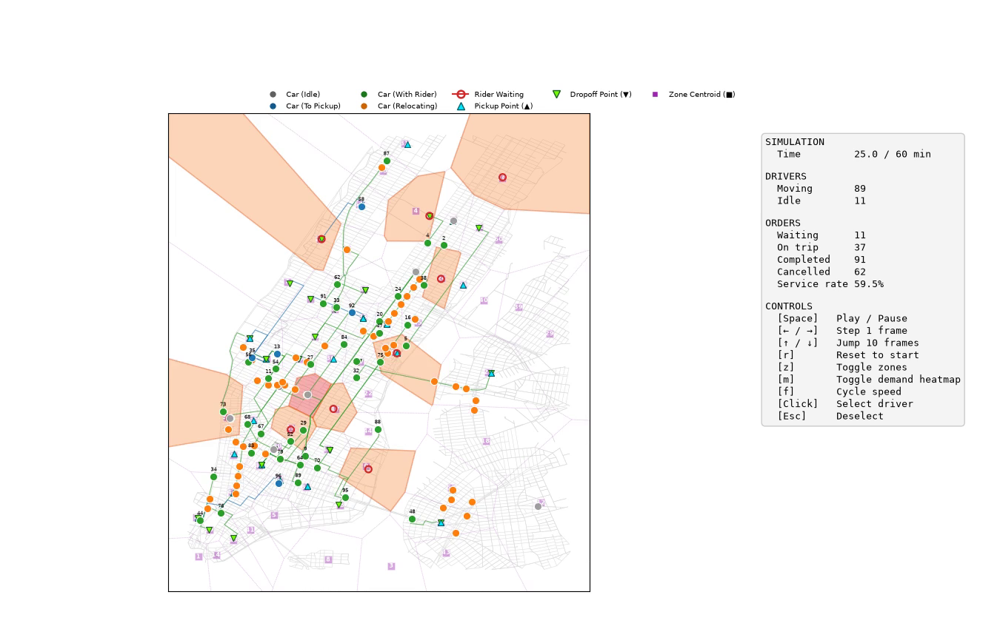
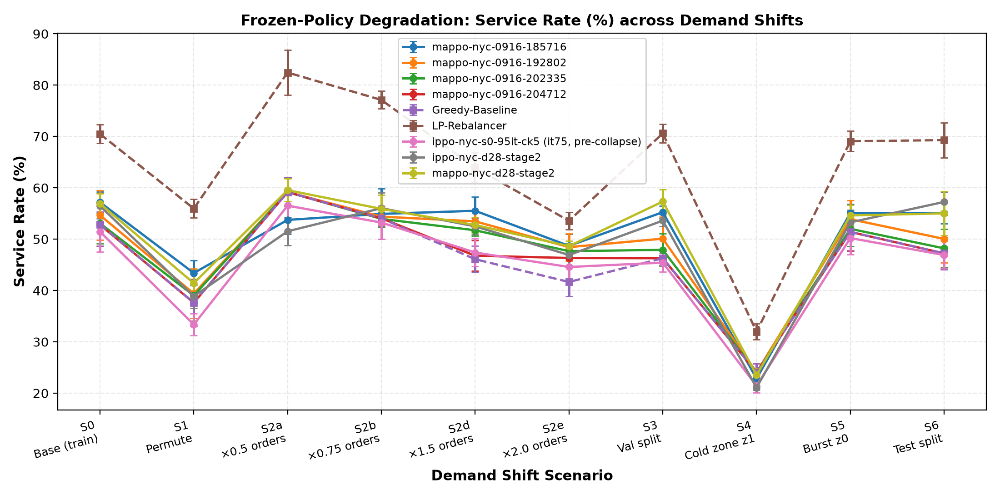
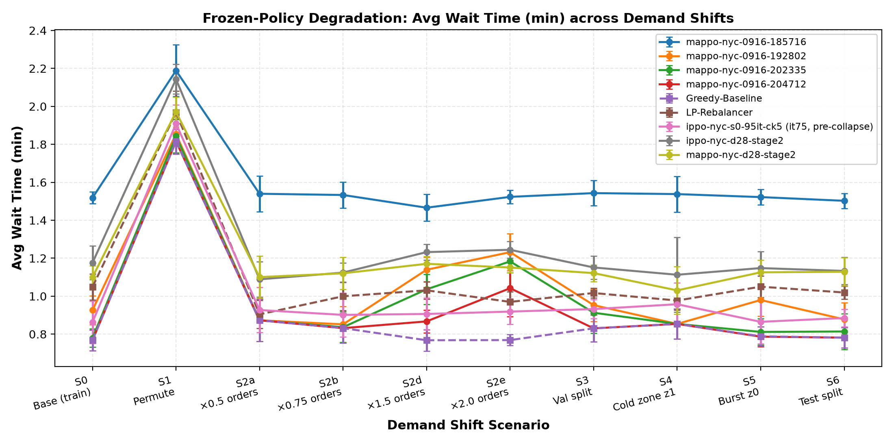
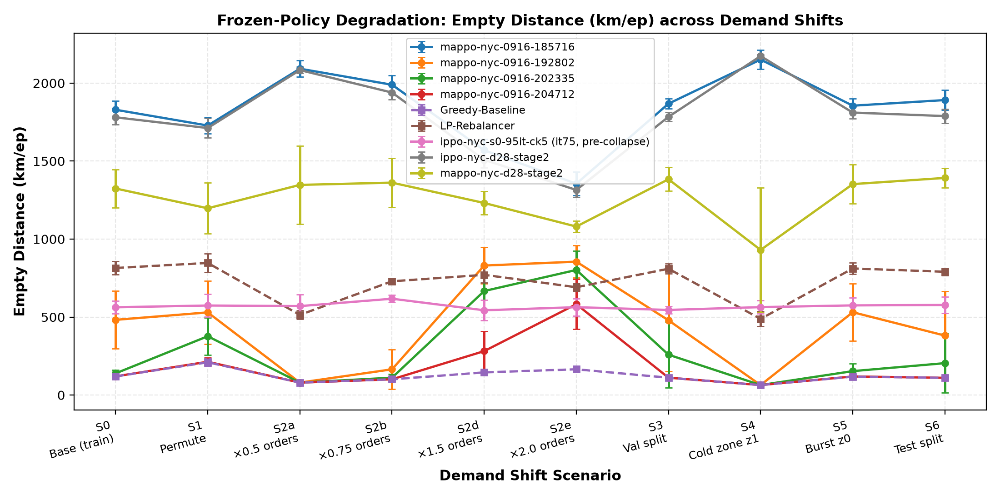

# MARL Fleet Rebalancing Under Demand Shift

**Research question:** How does a frozen fleet-rebalancing policy degrade when
passenger demand at deployment differs from the demand it was trained on — and do
independent (IPPO) and centralized-training (MAPPO) agents degrade differently,
relative to a tuned non-RL baseline?

This is a **measurement study**, not an algorithm paper: train on one demand
distribution, freeze the policy, stress-test on a parameterized family of
shifted distributions (S0–S6), plot degradation curves. Scope, hypotheses
(H1–H4), and non-goals live in `INTENT.md` — read it before changing
experiments; agents must refuse work that contradicts it.

## Study setup

- **Simulator:** [RideGym](https://github.com/RS2002/RideGym) (PettingZoo AEC
  zone-controller wrapper, one agent per taxi zone)
- **Study area:** Manhattan, NYC — 62 taxi zones, 100 drivers, real FHVHV
  demand windows (`data/nyc/`); Bandra West (`data/bandra_west.gpickle`) is
  kept only as the quick local test env
- **Agents:** IPPO and MAPPO (shared PPO backbone) + tuned rolling-horizon LP
  rebalancer (D27) and a greedy floor baseline
- **Runner:** `uv`; agents in PyTorch (CUDA)

<p align="center">
  
</p>

## Quick Start

```bash
uv sync                                  # install deps (incl. dev: pytest, ruff)
uv run python main.py                    # random-policy rollout on Bandra, MP4 viewer
uv run python main.py -o episode.mp4     # save MP4 instead of interactive view

uv run pytest                            # 16 tests, ~6 s
```

Note: `main.py` is a visualization smoke test on the Bandra toy env only —
experiments never import from it.

## Training & evaluation

```bash
# Train (NYC, validation-based best-checkpoint tracking every 4 iters)
uv run python -m marl_fleet_rebalancing.experiments.train \
    --env nyc --algo ippo --seed 0 --iterations 120 \
    --nyc-window-limit 500 --eval-interval 4 --eval-episodes 3

# Frozen-policy degradation eval across all shifts (S0–S6), 5 seeds
uv run python -m marl_fleet_rebalancing.experiments.shift_eval \
    --checkpoint runs/<run>/checkpoint_best.pt --episodes 5

# Regenerate degradation figures from results/shift_eval/summary.json
uv run python -m marl_fleet_rebalancing.experiments.plot_shifts
```

## Degradation Curves

Stress-testing frozen policies under the 10-shift suite (S0–S6):

<p align="center">
  
</p>

<p align="center">
  
  
</p>

## Repo map

| Path | What it is |
|---|---|
| `INTENT.md` | Research questions, H1–H4, non-goals — read first |
| `docs/HANDOFF.md` | Current state, what's broken, what's next |
| `docs/decisions.md` | Decision log (D1–D28); env/reward changes need an entry |
| `docs/demand-shift.md` | S0–S6 shift taxonomy (scenario IDs) |
| `docs/shift-results.md` | Current results + caveats |
| `docs/architecture.md` | Module map, KPI definitions |
| `src/marl_fleet_rebalancing/` | `env/` (PettingZoo wrapper), `agents/` (IPPO/MAPPO), `baselines/` (greedy, LP), `experiments/` (train, shift_eval, plotting), `demand/`, `config.py` |
| `results/` | Evaluation artifacts (figures, summary tables, CSVs) |
| `runs/` | Training checkpoints + metrics (git-ignored) |

## Experiment rules (short version)

Every reported result: ≥ 5 seeds, mean ± std. Policies are frozen after
training — no fine-tuning on shifted scenarios. Checkpoint selection runs on
the held-out validation split (`--eval-split val`, default), never on the
training split, and `best_checkpoint.json` records how each checkpoint was
picked. Shifted test scenarios are touched only for final evaluation. Full
rules: `AGENTS.md`.

## Current status

- Env v1.9 (D22–D28): zone ownership, neighbor relocation, reward rescale
  (D25), relocation arrival bonus (D28), winlim 500. Config is the contract
  — no magic numbers.
- Baselines tuned (D27): the LP rebalancer leads every shift on service rate but trades substantially higher empty distance for that gain; report both KPIs.
  RL policies are not competitive with this tuned throughput baseline.
- Late-training relocation collapse diagnosed (pay-now/pay-later reward
  asymmetry) and mitigated via the D28 arrival bonus + validation selection
  on the held-out split — fixed 2026-09-17 and regression-locked in
  `tests/test_training_validation.py`.
- Paired D28 comparison complete (5 training seeds/algo): MAPPO holds a
  modest, consistent service-rate edge; shift retention tied ~86.7%; full
  verdict in `docs/shift-results.md`.
