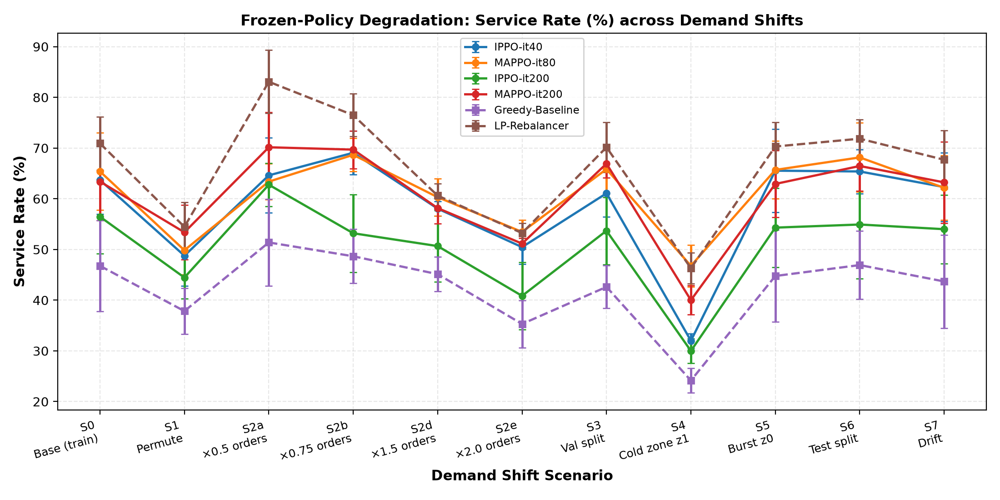
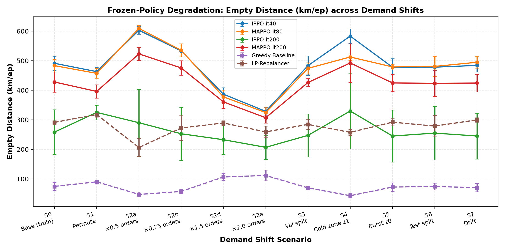
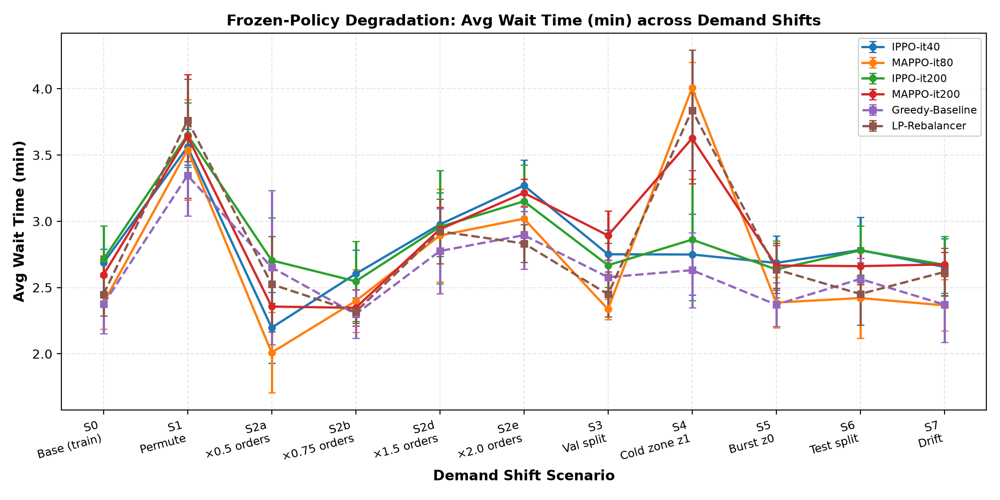

# MARL Fleet Rebalancing Under Demand Shift

**Research question:** How does a frozen fleet-rebalancing policy degrade when
passenger demand at deployment differs from the demand it was trained on — and do
independent (IPPO) and centralized-training (MAPPO) agents degrade differently,
relative to a tuned non-RL baseline?

This is a **measurement study**, not an algorithm paper: train on one demand
distribution, freeze the policy, stress-test on a parameterized family of
shifted distributions (S0–S7), plot degradation curves. Scope, hypotheses
experiments; agents must refuse work that contradicts it.

## Study setup

- **Simulator:** [RideGym](https://github.com/RS2002/RideGym) (PettingZoo AEC
  zone-controller wrapper, one agent per taxi zone)
- **Study area:** Manhattan, NYC — 16 taxiest taxi zones, 26 drivers, real
  FHVHV demand windows (`data/nyc16/`, built by
  `scripts/build_zone_subset.py`); the full 62-zone build and Bandra West
  (`data/bandra_west.gpickle`) are kept as reference / quick local test env
- **Agents:** IPPO and MAPPO (shared PPO backbone) + tuned rolling-horizon LP
  rebalancer (D27) and a greedy floor baseline
- **Runner:** `uv`; agents in PyTorch (CUDA)

## Quick Start

```bash
uv sync                                  # install deps (incl. dev: pytest, ruff)
uv run python main.py                    # random-policy rollout on Bandra, MP4 viewer
uv run python main.py -o episode.mp4     # save MP4 instead of interactive view

uv run pytest                            # 16 tests, ~6 s
```

Note: `main.py` is a visualization smoke test on the Bandra toy env only —
experiments never import from it.

## Training & evaluation

```bash
# Train (NYC, validation-based best-checkpoint tracking every 4 iters)
uv run python -m marl_fleet_rebalancing.experiments.train \
    --env nyc --algo ippo --seed 0 --iterations 120 \
    --nyc-window-limit 500 --eval-interval 4 --eval-episodes 3

# Frozen-policy degradation eval across all shifts (S0–S7), 5 seeds
uv run python -m marl_fleet_rebalancing.experiments.shift_eval \
    --checkpoint runs/<run>/checkpoint_best.pt --episodes 5

# Regenerate degradation figures from a fresh eval summary
uv run python -m marl_fleet_rebalancing.experiments.plot_shifts
```

## Degradation Curves

Stress-testing frozen policies under the S0–S7 shift taxonomy, 5 seeds,
deterministic argmax actions: IPPO-it40 / MAPPO-it80 / IPPO-it200 /
MAPPO-it200 vs greedy and the re-tuned LP baseline (D89). Figures regenerate
with `plot_shifts` after a shift eval run.





Caveat: these curves use greedy (argmax) frozen actions. With sampled actions
the same four checkpoints all score ~72% service rate on S0; the
argmax-vs-sampled gap is itself a measured result (see D89).

## Repo map

| Path | What it is |
|---|---|
| `docs/HANDOFF.md` | Current state, what's broken, what's next |
| `docs/demand-shift.md` | S0–S7 shift taxonomy (scenario IDs) |
| `docs/architecture.md` | Module map, KPI definitions |
| `src/marl_fleet_rebalancing/` | `env/` (PettingZoo wrapper), `agents/` (IPPO/MAPPO), `baselines/` (greedy, LP), `experiments/` (train, shift_eval, plotting), `demand/`, `config.py` |
| `results/` | Regenerated eval artifacts (git-ignored; figures copied to `docs/figures/`) |
| `docs/figures/` | Committed degradation curves used in this README |
| `runs/` | Training checkpoints + metrics (git-ignored) |

## Experiment rules (short version)

Every reported result: ≥ 5 seeds, mean ± std. Policies are frozen after
training — no fine-tuning on shifted scenarios. Checkpoint selection runs on
the held-out validation split (`--eval-split val`, default), never on the
training split, and `best_checkpoint.json` records how each checkpoint was
picked. Shifted test scenarios are touched only for final evaluation. Full
rules: `AGENTS.md`.

## Current status

- Env overhauled (D22–D26): zone ownership, neighbor relocation, reward
  rescale (D25), winlim 500. Config is the contract — no magic numbers.
- Baselines tuned (D27): the LP rebalancer leads every shift; RL policies are
  not yet competitive.
- Both PPO variants **collapse late in training** under the current reward
  economics (relocation becomes net-negative), so checkpoint selection by
  validation is the load-bearing protocol — it had two bugs (train-split
  selection + training-RNG contamination), fixed 2026-09-17 and
  regression-locked in `tests/test_training_validation.py`.
- 2026-10-08 (D89): all checkpoints under `runs/` predate the current
  obs-encoder and no longer load; IPPO and MAPPO were retrained (40/80/200
  iters) and re-evaluated across S0–S7 against a re-tuned LP
  (`lookahead=5.0`, `deficit_penalty_scale=1.0`). LP leads the frontier
  (~71% service @ ~291 km on S0); RL sits below it on service and above it on
  empty distance, as in D79–D81. H1–H4 remain unanswered.
